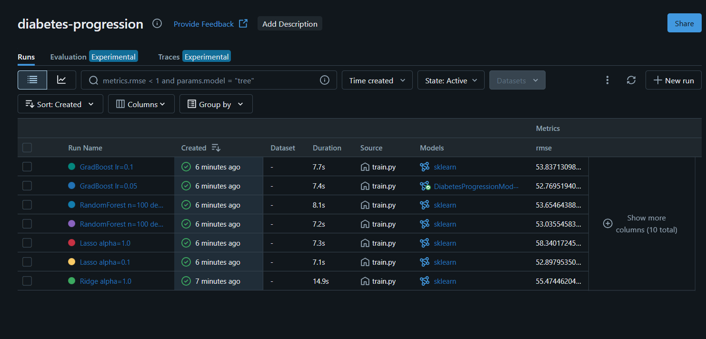
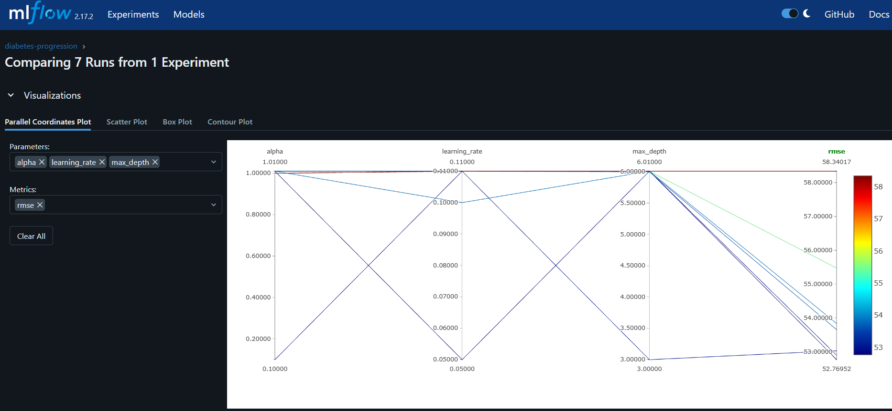
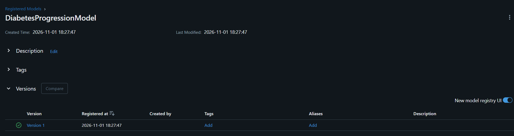
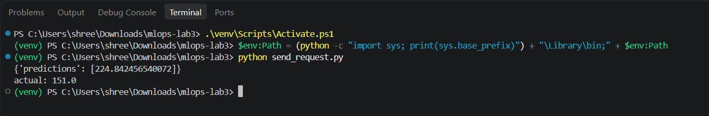

# MLOps Lab 3: Experiment Tracking with MLflow

Jaiyashree Vinaitheertha Kumaravelu
DADS7305 - Machine Learning Operations

## What this lab does

The original lab tracks ElasticNet, Linear Regression and Random Forest runs on the Wine Quality dataset using MLflow's default `mlruns` folder. I did the same idea on a different problem and changed a few things:

- Dataset: sklearn's diabetes dataset (predicting disease progression after one year). It ships with sklearn, so no download is needed.
- Models: Ridge, Lasso, Random Forest and Gradient Boosting, with a couple of hyperparameter values each (7 runs total).
- Tracking backend: SQLite (`mlflow.db`) instead of the plain file store. This is needed for the Model Registry to work locally.
- Named experiment (`diabetes-progression`) set in code instead of renaming the Default experiment afterwards.
- Each run also logs a predicted vs actual plot and a `model_type` tag.
- After training, the run with the lowest test RMSE is registered as `DiabetesProgressionModel`.
- `predict.py` picks the best run with `mlflow.search_runs` instead of hardcoding a run id path.
- The lab's `serving.py` shows how MLflow records pip requirements for a logged model (using xgboost on Iris). I kept that part small: `predict.py` downloads and prints the `requirements.txt` MLflow saved for the best model, which is what `mlflow models serve` uses to rebuild the environment. No xgboost needed.

## Files

| File | Purpose |
|---|---|
| `train.py` | trains and logs all runs, registers the best model |
| `predict.py` | loads the best run's model and predicts on 5 rows |
| `send_request.py` | sends one row to the served model over REST |
| `requirements.txt` | dependencies |

## How to run

```
python -m venv venv
venv\Scripts\activate          # Windows
pip install -r requirements.txt

python train.py
```

Optional args change the Ridge alpha and number of trees, e.g. `python train.py 0.5 200`. Running it again adds new runs to the same experiment.

Open the UI (has to point at the same SQLite file):

```
mlflow ui --backend-store-uri sqlite:///mlflow.db
```

Then go to http://localhost:5000.

Load the best model and predict:

```
python predict.py
```

## Serving the model

`predict.py` prints the folder of the best model. Serve it from that folder in one terminal:

```
mlflow models serve -m mlruns/1/<RUN_ID>/artifacts/model -p 5001 --env-manager local
```

`--env-manager local` uses the current venv instead of building a new environment. In a second terminal (venv activated):

```
python send_request.py
```

This sends one row of the diabetes data to the `/invocations` endpoint and prints the prediction.

## Results

| Run | Test RMSE |
|---|---|
| GradBoost lr=0.05 | 52.77 |
| Lasso alpha=0.1 | 52.90 |
| RandomForest depth=3 | 53.04 |
| RandomForest depth=6 | 53.65 |
| GradBoost lr=0.1 | 53.84 |
| Ridge alpha=1.0 | 55.47 |
| Lasso alpha=1.0 | 58.34 |

All models land fairly close. The diabetes dataset is small (442 rows), so the tree models don't get much advantage over a regularized linear model. Lasso with a large alpha does worst because it zeroes out too many features.

## Screenshots

Experiment runs in the MLflow UI:


Comparing runs:


Registered model:


Served model responding to a request:

